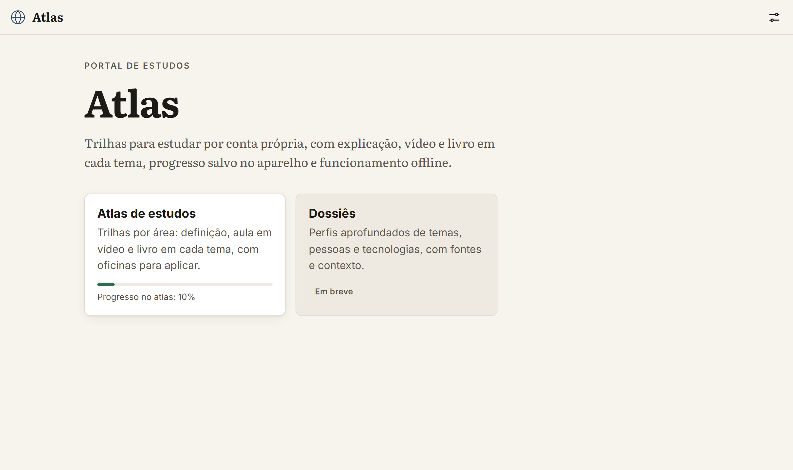
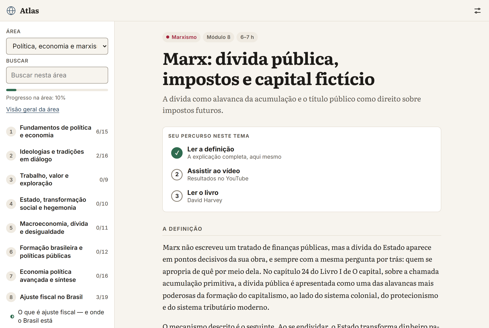
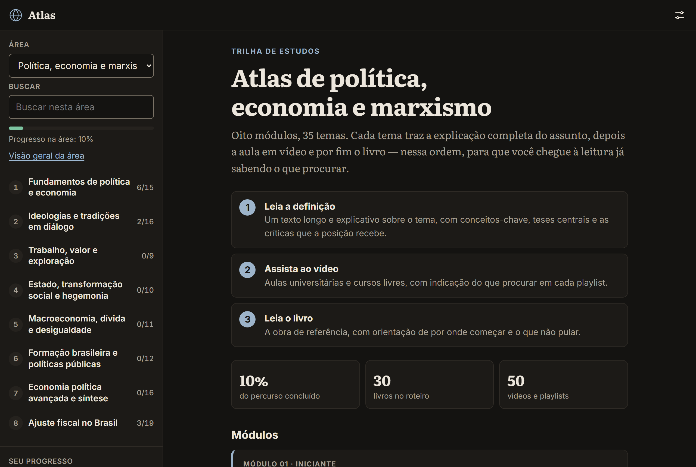
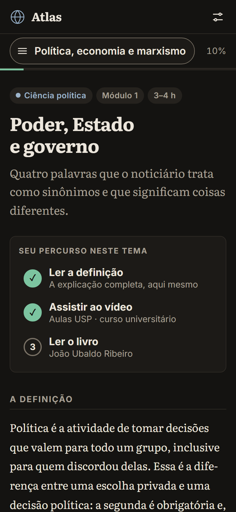
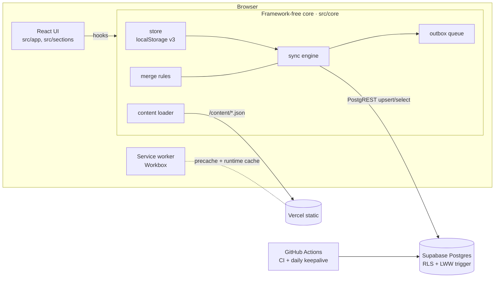
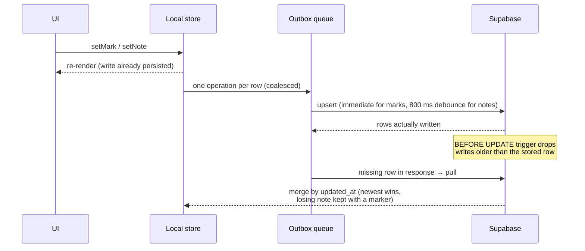

# Atlas

**A self-directed study portal that works offline and syncs across devices.**
Each topic comes with a long-form explanation, a curated video and a book, plus
progress tracking, personal notes and an AI tutor prompt. Built with React and
TypeScript as a static site, with offline-first, per-row sync to Supabase.

> **Live demo:** the link is added here after the first Vercel deploy. Visitors
> use the site with local storage only; sign-in is restricted to the author.

The content and the interface are in Brazilian Portuguese; the code,
architecture notes and this README are written for a broader audience.

## Overview and motivation

Atlas started as a single HTML file I used to study politics and economics:
one long page per topic, checkboxes for *read the definition → watch the
video → read the book*, and notes in `localStorage`. It worked, until I wanted
the same progress on my phone and my laptop, and more study areas than one.

This repository is the result of turning that file into a small product
without losing what made it useful:

- **It must never lose a note or a checkmark.** Offline is the normal case on
  a phone, so every write goes to the device first and syncs later. Conflicts
  are resolved per row, and when two devices edit the same note, the losing
  version is kept, not discarded.
- **Content is data.** A new study area is a JSON file plus a manifest entry.
  No code changes, and CI validates the content on every push.
- **The portal grows by sections.** The study atlas is the first section; a
  second one (in-depth dossiers on topics, people and technologies) is
  planned, and adding it touches only its own folder and one registry line.
- **Free to run.** Static hosting on Vercel, the Supabase free tier, and a
  daily GitHub Action that keeps the database awake.

## Screenshots

| Portal | Topic page (light) |
|---|---|
|  |  |

| Area cover (dark) | Phone (dark) |
|---|---|
|  |  |

## Features

- **Portal of sections:** the home page lists sections from a single registry.
  Planned sections show as "coming soon".
- **Study areas** loaded on demand from `content/areas.json` and one
  `curriculum.json` per area. Each area has modules, topics and hands-on
  workshops.
- **Topic pages** with a three-step path (definition, video, book), key
  concepts, core theses, criticism, self-check questions and per-step
  checkmarks.
- **AI tutor prompt:** one click copies a Socratic tutoring prompt built from
  the topic, ready to paste into Claude or ChatGPT.
- **Notes** saved on every keystroke. A remote update never overwrites the
  text you are typing; it is applied when you leave the field.
- **Search** within an area or across all areas.
- **Offline-first sync:**
  - local writes first, then per-row upserts;
  - checkmarks sync immediately, notes after an 800 ms debounce;
  - a persisted outbox queue;
  - last-write-wins enforced by a Postgres trigger;
  - conflicting note versions preserved with a dated marker.
- **Sign-in** by magic link or 6-digit code. Visitors never see the account UI;
  the author signs in at an unlisted `/entrar` route.
- **PWA:** works offline after the first visit, installable, and only the
  areas you opened are cached.
- **Backup:** export and import as JSON, merging by timestamp. Also a
  "reset everything" action, propagated to all synced devices, and a printable
  PDF of a whole area.
- **Accessibility:**
  - WCAG AA contrast, checked by tests on design tokens and with real
    rendering;
  - keyboard-operable dialogs with focus trapping;
  - no horizontal scroll at 320 px with the largest text size;
  - light, dark and auto themes, and four text sizes.

## Architecture



The code is split in three layers:

| Layer | Folder | Knows about React? | Responsibility |
|---|---|---|---|
| Core | `src/core` | no | state, merge rules, outbox queue, backup, content loading, sync engine |
| App shell | `src/app`, `src/ui` | yes | router, layout, account UI, settings, design system |
| Sections | `src/sections/*` | yes | each section owns its routes and pages; the shell only iterates the registry |

The core is plain TypeScript with dependency injection (storage, clock, timers,
Supabase loader). That is what makes the two-device sync scenarios testable
without a browser or a network. React talks to it through
`useSyncExternalStore`.

More detail: [docs/arquitetura.md](docs/arquitetura.md) (Portuguese).

## Offline-first sync



- **Granularity:** one row per (user, item, checkmark) and one per (user,
  note). Two devices editing different things never conflict.
- **Ordering:** each entry carries the device timestamp of the edit. The
  server keeps the newest one, and the client merges by the same rule.
- **When it syncs:** on app open, when the tab becomes visible again, on
  reconnect, and after a failed request (with retry).
- **Reset:** a `resetAt` tombstone makes "reset everything" win over older
  rows still on the server.

Full rules and edge cases: [docs/sincronizacao.md](docs/sincronizacao.md).

## Testing strategy

| Level | Tool | What it covers |
|---|---|---|
| Unit | Vitest (Node) | merge rules, queue, store, backup, legacy URL mapping, service worker cache rules, content and deploy scripts |
| Sync scenarios | Vitest + in-memory fake backend | two-device scenarios: offline queue, conflicts, reset, sign-out mid-request; the fake reproduces the LWW trigger and RLS |
| Components | Vitest + Testing Library + jsdom | every feature of the inventory, rendered with the real core; axe-core on each screen |
| End-to-end | Playwright (Chromium) on the production build | clean routes and reloads, legacy `#` links, scroll restoration, offline navigation, service worker replacement, 320 px layout, axe with real color contrast in both themes |
| Database | PostgreSQL 16 in Docker | migration, RLS isolation between users, last-write-wins trigger |
| Guards | Node scripts in CI | initial JS ≤ 150 KB gzip with Supabase lazy-loaded; no secret keys in the repo or the bundle |

The project follows a spec-driven workflow: every behavior traces back to a
business rule and acceptance criterion in
[`especificacoes/`](especificacoes/portal-react/visao.md), and every scenario
names the test that covers it.

## Tech stack

- **Front end:** React 19, TypeScript (strict), Vite, React Router.
- **Styling:** CSS Modules and design tokens as CSS custom properties.
  Self-hosted Literata and Inter fonts.
- **Offline:** service worker built with Workbox via `vite-plugin-pwa`.
- **Back end:** Supabase (Postgres, Row Level Security, auth by magic link and
  OTP), accessed with `supabase-js` and no server code of our own.
- **Hosting and automation:** Vercel (static), GitHub Actions for CI and the
  database keepalive.
- **Quality:**
  - Vitest, Testing Library, Playwright and axe-core;
  - ESLint with typescript-eslint, react-hooks and jsx-a11y.

Dependencies are pinned to exact versions published at least two weeks earlier
([ADR-011](docs/adr/0011-versoes-de-dependencias.md)).

## Running locally

Requirements: Node 22 (≥ 22.22.2). Docker is only needed for the database tests.

```bash
npm ci
npm run dev          # http://localhost:5173
```

Without Supabase settings the app runs in local-only mode. To enable sync,
copy `.env.example` to `.env.local` and fill in the project URL and the public
(anon/publishable) key.

| Command | What it does |
|---|---|
| `npm run typecheck` | TypeScript, strict, app + service worker |
| `npm run lint` | ESLint |
| `npm test` | Vitest (core, sync scenarios, components, scripts) |
| `npm run e2e` | Playwright against the production build (`npx playwright install chromium` once) |
| `npm run validate` | validates every area's content |
| `npm run build` | production build to `dist/` |
| `npm run size` | initial JS budget (run after build) |
| `npm run secrets` | secret scan of the repo and `dist/` |
| `bash tests/db/run.sh` | migration and SQL tests in a disposable PostgreSQL (Docker) |

## Deployment

1. **Supabase:**
   - create a free project;
   - run [`supabase/migrations/0001_init.sql`](supabase/migrations/0001_init.sql);
   - create your user, then disable sign-ups;
   - add `https://YOUR-SITE/**` to the redirect URLs;
   - add `{{ .Token }}` to the magic link email template.
2. **Vercel:**
   - import the repository; [`vercel.json`](vercel.json) selects the Vite
     preset;
   - set `VITE_SUPABASE_URL` and `VITE_SUPABASE_ANON_KEY`.
3. **GitHub:** add the same two values as repository secrets for the daily
   keepalive workflow.

The `service_role` key is never used anywhere in this project. Step-by-step
guide with screens and troubleshooting: [docs/deploy.md](docs/deploy.md).

## Project structure

```
src/
  core/            framework-free domain: store, merge, queue, backup, content, sync, legacy URLs
  app/             shell: router, layout, account UI, settings, services wiring
  sections/        portal sections (registry.ts + one folder per section)
    atlas/         study atlas: layout, pages, components, print view
  ui/              design system: tokens, theme, primitives, Sheet, Toast
  sw.ts            service worker (Workbox)
public/content/    areas.json manifest + one curriculum.json per area
supabase/          database migration
scripts/           content validation, size budget, secret scan, keepalive, icons, screenshots
tests/             core/ (unit + sync), ui/ (components), scripts/, db/ (SQL in Docker)
e2e/               Playwright specs
docs/              architecture, sync, content, deploy, ADRs (Portuguese)
especificacoes/    vision, spec, plan, contracts and execution log of each change
```

## Decisions

Architecture decisions are recorded as ADRs (in Portuguese), each with
context, alternatives, decision, consequences and a review trigger:

| ADR | Decision |
|---|---|
| [0001](docs/adr/0001-react-typescript-vite.md) | React + TypeScript + Vite as a static site (not Next.js, not vanilla) |
| [0002](docs/adr/0002-roteamento.md) | React Router with clean URLs and legacy `#` link redirects |
| [0003](docs/adr/0003-registro-de-secoes.md) | Section registry: new sections without touching the shell |
| [0004](docs/adr/0004-estado-na-interface.md) | Framework-free core exposed via `useSyncExternalStore` (no Redux/Zustand) |
| [0005](docs/adr/0005-configuracao-por-ambiente.md) | Supabase settings through environment variables |
| [0006](docs/adr/0006-supabase-js-sob-demanda.md) | `supabase-js` from npm, lazy-loaded off the critical path |
| [0007](docs/adr/0007-offline-com-workbox.md) | Offline with a custom Workbox service worker at the old path |
| [0008](docs/adr/0008-estilos-e-tokens.md) | CSS Modules and tested design tokens; self-hosted fonts |
| [0009](docs/adr/0009-estrategia-de-testes.md) | Vitest + Testing Library + Playwright + axe |
| [0010](docs/adr/0010-conteudo-em-public.md) | Content served as static JSON from `public/content` |
| [0011](docs/adr/0011-versoes-de-dependencias.md) | Exact dependency versions, at least two weeks old |

## Roadmap

- **Dossiers section:** in-depth profiles of topics, people and technologies.
  It will have its own specification and reuse the core and design system.
- **More study areas:** history, economics, philosophy, science and
  technology are already in the manifest as planned.
- **Optional public sign-in:** the account UI is author-only for now (a
  product decision, not a technical limit).

## License

[MIT](LICENSE) © 2026 Diogo Graciano.
